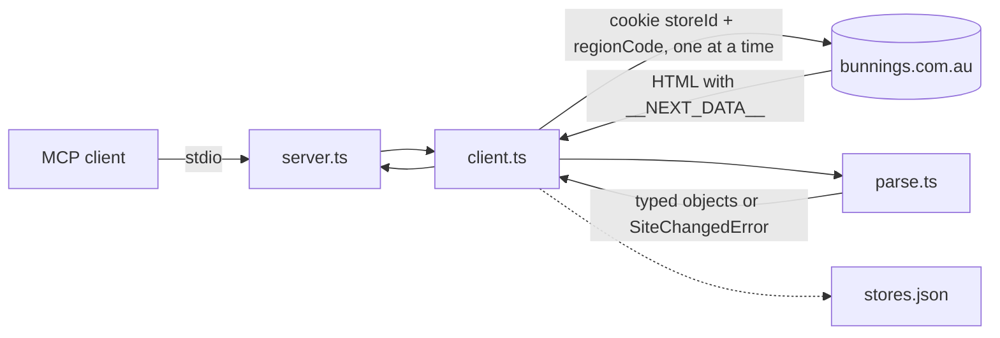

# Architecture

`bunnings-mcp` reads the data that bunnings.com.au embeds in its server-rendered pages and exposes it as six MCP tools over stdio. The design goal is that everything fragile about the website lives in one place.

## Modules

| file | role |
|---|---|
| `src/server.ts` | MCP adapter. Maps each tool to a client call and formats errors. No site knowledge. |
| `src/client.ts` | The `Bunnings` client: `search`, `getProduct`, `checkStock`, `stores`. Owns URLs, cookies, throttling, caching, timeouts and store-cookie checks. |
| `src/parse.ts` | Pure functions from page JSON to typed domain objects, plus `SiteChangedError`. No network, no clock. |
| `src/stores.ts` | Store list loading, matching and distance sorting. Pure over an array. |
| `src/session.ts` | The per-process default store. |
| `src/cache.ts` | A small TTL cache with an injectable clock. |
| `data/stores.json` | Every Australian store, built by `npm run build:stores`. |

## Data flow

A request goes: tool call, client builds the URL and cookies for the store, waits its turn, fetches with a timeout, extracts the `__NEXT_DATA__` JSON, hands it to a parser, and checks that the page really ran for the requested store. Parsed pages are cached for five minutes per store and path.

## The fragile surface

These are the only places that depend on the website's current shape. If one changes, a parser throws `SiteChangedError` naming the missing path, and the live contract tests fail.

- The `<script id="__NEXT_DATA__">` tag.
- `props.pageProps.dehydratedState.queries[]`, and the query names `coveo-search`, `retail-product`, `product-retail-price`, `product-fulfilment` and `product-aisle-item-location`.
- Search results at `queries[coveo-search].state.data.results[].raw` (`code`, `name`, `price`, `cprice`, `productroutingurl`, `rating`).
- Stock and aisle at `inStorePickUpData` (`stock`, `inStoreItemLocation`, `inStoreStockMsg`).
- Store pages at `props.pageProps.initialState.store.data` (`name` is the store id, `pricingRegion` is the region code).
- The `storeId` and `regionCode` cookies. Product pages need both. Search works with `storeId` alone but the client sends both everywhere. The client checks the store id the page reports and fails if the cookie was ignored.
- `/_p{itemNumber}` redirecting to the canonical product page, and `/stores.xml` listing store pages.

The token-gated `apis.prod.bunnings.com.au` endpoints are not used. See [ADR 0001][1].

## Failure behaviour

- A missing key or page throws `SiteChangedError`. Nothing is guessed. A missing stock number is `unknown`, never zero.
- HTTP 403, 429 and 503 raise `BlockedError` and are not retried. Other non-200 responses raise `HttpError`. In `check_stock` a 404 on one item becomes an `unknown` row and the rest of the list continues.
- One request in flight, 500 ms between requests, 20 second timeout.

## Design framing

- Deep module (Ousterhout, *A Philosophy of Software Design*): `client.ts` presents four small methods and hides URLs, cookies, JSON paths and query keys. The MCP layer is a thin adapter so a site change touches `client.ts` and `parse.ts` only.
- Dependency rule (Martin, *Clean Architecture*, scaled down): parsers and domain types are pure functions over JSON and depend on nothing. The client depends on them, never the reverse. There are no single-implementation interfaces and no DI framework. `fetch` and the clock are plain constructor options so tests can stub them.
- Tracer bullet (Hunt and Thomas, *The Pragmatic Programmer*): `get_product` was built first, end to end over stdio, then the other tools were added around it.
- Fail loudly and politely (Nygard, *Release It!*): timeouts on every call, one request in flight with a delay, a short cache, no retries, and a named error when the page shape drifts.
- Evals over vibes (Huyen, *AI Engineering*): the choice of search source is measured, see [the search benchmark][2].

## Known issues

- Bay numbers can differ between `product-fulfilment` and `product-aisle-item-location` for the same item and store, with the same aisle. The server reports the fulfilment value because it is the one the product page displays. Examples are in [the benchmark notes][3].
- Search results carry no stock, so `in_stock_only` costs one product page per candidate.
- Each product page is about 700 KB. A 30 item `check_stock` takes about 30 seconds.

[1]: adr/0001-read-server-rendered-page-data.md
[2]: eval/search-benchmark.md
[3]: eval/search-benchmark.md#known-issue-bay-mismatch
